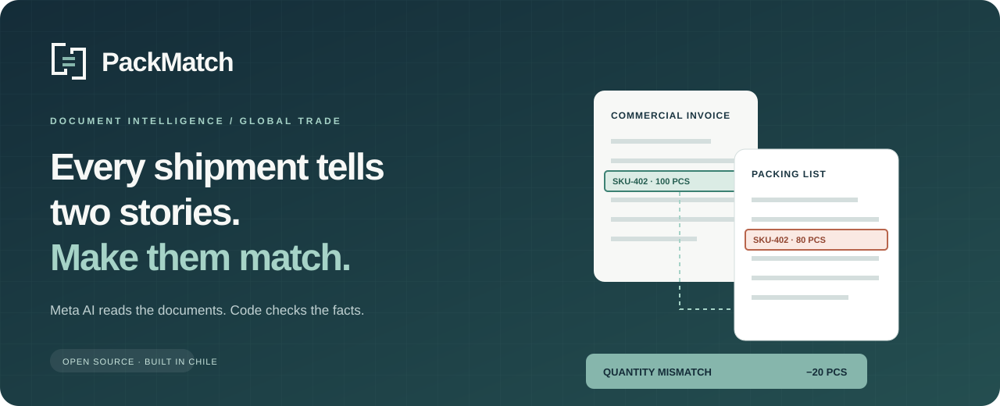
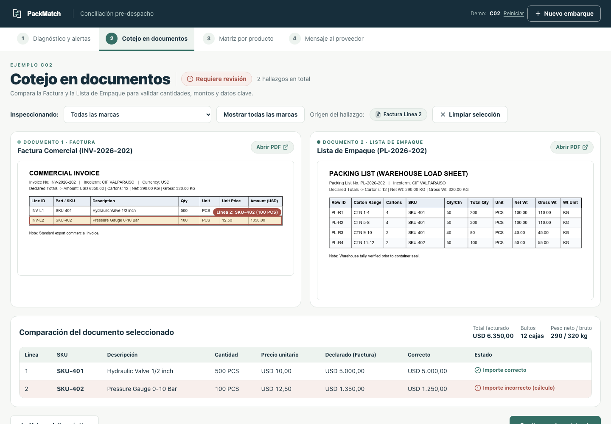
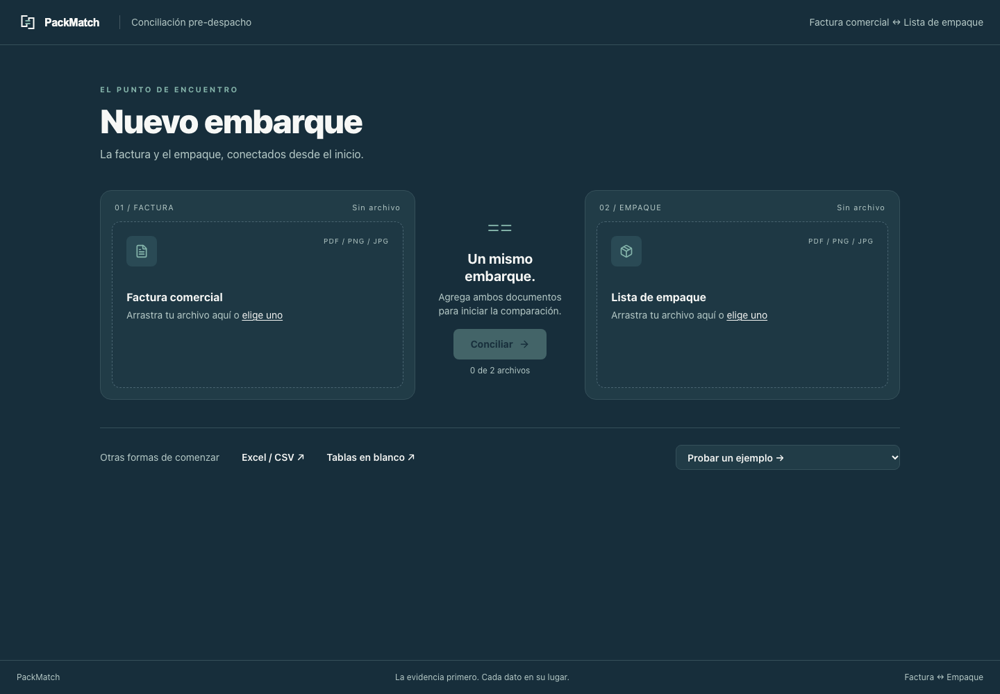
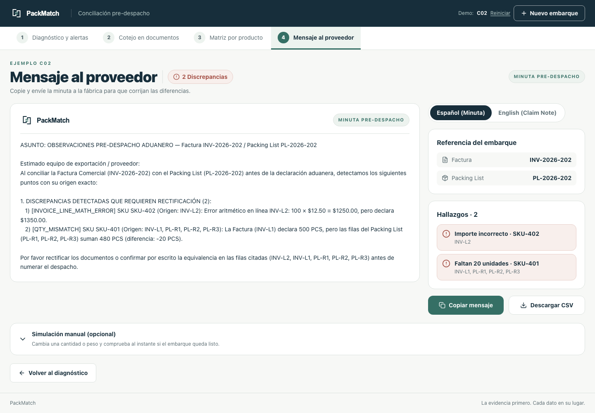
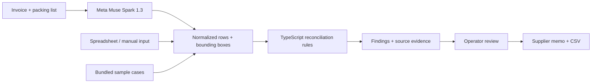

<p align="center"></p>

<p align="center">
  <a href="https://packmatch.netlify.app"></a>
  <a href="https://github.com/alonsinhoiu/packmatch/actions/workflows/ci.yml"></a>
  <a href="LICENSE"></a>
  
</p>

<p align="center"><strong>Catch invoice and packing list discrepancies before dispatch.</strong><br />Visual evidence. Explicit rules. A clear message to your supplier.</p>

<p align="center"><a href="#try-it-in-60-seconds">Try it</a> · <a href="#how-it-works">Architecture</a> · <a href="#run-locally">Run locally</a> · <a href="docs/VALIDATION.md">Validation</a> · <a href="docs/README.es.md">Español</a></p>

## The problem

A commercial invoice says 100 pieces. The packing list says 80. Someone needs to notice, locate the evidence and ask the supplier to resolve it before the shipment moves.

PackMatch brings that review into one workspace. Meta's `muse-spark-1.3` extracts structured rows and visual coordinates; a TypeScript rules engine compares quantities, amounts, weights and packaging. Unresolved unit conversions stay visible for an operator to confirm.

> **AI reads. Code reconciles. People resolve ambiguity.**

## Try it in 60 seconds

1. Open **[packmatch.netlify.app](https://packmatch.netlify.app)**.
2. Choose a sample shipment. **C02** contains quantity and amount discrepancies; **C06** includes an ambiguous set-to-piece conversion.
3. Follow the four steps: diagnosis → source documents → product matrix → supplier message.
4. Inspect a highlighted source row and export a supplier memo or CSV.

The seven bundled examples and spreadsheet/manual entry work without an API key. Live PDF/image extraction requires a server-side Meta API key.

<p align="center"></p>
<p align="center"><sub>From a discrepancy to its source, without leaving the review.</sub></p>

## What you can do

| Capability | What it gives you |
| --- | --- |
| PDF/image extraction | Structured invoice and packing list rows with source bounding boxes |
| Spreadsheet and manual input | An editable route into the same reconciliation workflow |
| Rule-based checks | Quantity differences, line arithmetic, weight inconsistencies and packaging checks |
| Visual traceability | Findings linked to their originating document rows |
| Operator review | Explicit confirmation of missing pieces-per-set factors |
| Supplier handoff | Spanish/English memos, operator audit entries and CSV export |
| Interface language | Global Español/English/简体中文 switcher, independent from the memo language |

Three UI languages, two selectors: the **header switcher** (Español / English / 简体中文) changes the whole UI instantly (persisted in `localStorage` as `packmatch.uiLocale`, Spanish by default, `?lang=` untouched) without resetting the case, files, edits, step, audit log or AI extraction; the **message selector** (step 4 and side panel) changes only the memo content (`memoLang`, honoring `?lang=en|es`). Either combination works — e.g. English UI with a Spanish memo. See [Español](docs/README.es.md) for details. Multilingual extraction scope and limits: [docs/MULTILINGUAL.md](docs/MULTILINGUAL.md).

<details>
<summary><strong>See the workspace and supplier memo</strong></summary>





</details>

## How it works



**Meta AI** handles document perception. The server requests structured JSON and normalized row coordinates, then validates and normalizes the response. **TypeScript** handles reconciliation, including explicit unit factors and shared carton handling. Model extraction can still make mistakes; users can inspect and edit the source data.

| Read the implementation | Responsibility |
| --- | --- |
| [`src/app/api/extract/route.ts`](src/app/api/extract/route.ts) | Meta API calls, input limits and extraction |
| [`src/lib/normalize-extracted.ts`](src/lib/normalize-extracted.ts) | Schema normalization and file signature validation |
| [`src/lib/reconcile.ts`](src/lib/reconcile.ts) | Deterministic reconciliation rules |
| [`src/lib/reconcile-presentation.ts`](src/lib/reconcile-presentation.ts) | Operator-facing comparisons |
| [`src/lib/supplier-memo.ts`](src/lib/supplier-memo.ts) | Bilingual memos and CSV escaping |
| [`src/components/PackMatchStepper.tsx`](src/components/PackMatchStepper.tsx) | Review workflow |

## Run locally

Use **Node.js 22.18+** (or Node.js 24) and npm. The verification scripts use native TypeScript stripping.

```bash
git clone https://github.com/alonsinhoiu/packmatch.git
cd packmatch
npm ci
npm run dev
```

Open [localhost:3000](http://localhost:3000). For live extraction:

```bash
cp .env.example .env.local
# Add your own MODEL_API_KEY to .env.local, then restart the dev server.
```

The key stays on the server. Never add it to client code or commit it. The browser rasterizes PDFs for extraction; the server also has a PDF fallback using `pdftoppm` (Poppler), or `sips` on macOS. Multi-page shipment handling is limited; use individual pages for the demo.

## Reproduce the checks

```bash
npm run test:qa          # 67 regression checks (incl. shipment review and visual grounding)
npm run verify-parity    # Seven fixtures + recorded model extractions
npx tsc --noEmit         # Type checking
npm run build           # Production build
```

On the bundled seven-case dataset, the parity script finds **13/13 expected findings** with exact source origins and zero extra alerts, both from ground truth inputs and recorded API extractions. This is a small synthetic benchmark, not a guarantee for unseen documents. Replaying recorded extractions does not call Meta or spend API credits. See [validation details and limitations](docs/VALIDATION.md).

## Deployment

The application uses **Next.js 15, React 19, TypeScript and Tailwind CSS 4**, with a server route for Meta API calls. [`netlify.toml`](netlify.toml) provides the build configuration. Configure `MODEL_API_KEY` in the hosting provider's server environment and deploy with `npm run build`.

Documents used for live extraction are sent to Meta's API. The extraction route has file checks, request limits, a timeout and an in-memory rate limit. The rate limit is per process and does not provide shared protection across serverless instances. This prototype does not include user accounts or persistent shipment storage.

## Project context

Built by **[Alonso Céspedes](https://github.com/alonsinhoiu)** in Chile for the **Meta Global AI Developer Hackathon 2026**, under *Build for Your World*.

This repository publishes the existing hackathon prototype as an initial source snapshot. Git history starts at publication; it does not reconstruct the earlier development timeline. Fixtures are synthetic and included for reproducibility.

Contributions are welcome — see [CONTRIBUTING.md](CONTRIBUTING.md). Licensed under [MIT](LICENSE).
