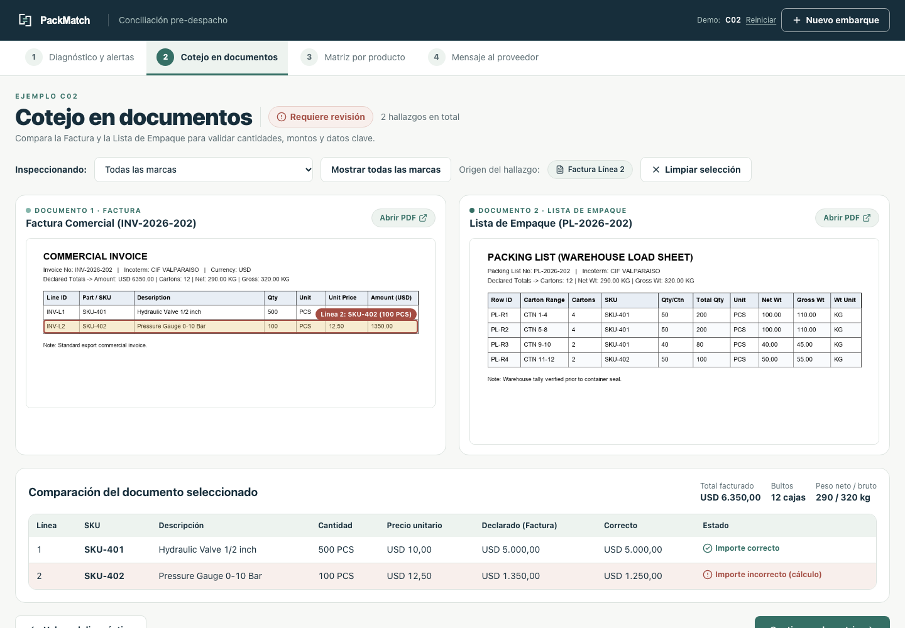

# PackMatch

**Detecta diferencias entre la factura comercial y la lista de empaque antes del despacho.**

[Probar la aplicación](https://packmatch.netlify.app) · [README técnico en inglés](../README.md)



Meta Muse Spark 1.3 lee los documentos y extrae filas con coordenadas visuales. Un motor de reglas en TypeScript coteja cantidades, importes, pesos y embalajes. El operador revisa la evidencia, confirma factores de conversión cuando faltan y genera una minuta en español o inglés para el proveedor.

## Pruébalo

1. Abre la demo y elige C02 para ver diferencias de cantidad e importe.
2. Recorre diagnóstico, cotejo de documentos, matriz por producto y mensaje al proveedor.
3. Prueba C06 para revisar una conversión de sets a piezas que requiere confirmación.

Los siete ejemplos y el ingreso manual o desde planillas funcionan sin clave de API. La extracción de documentos nuevos requiere `MODEL_API_KEY` en el servidor y envía esos documentos a Meta.

## Desarrollo local

Requiere Node.js 22.18 o superior.

```bash
git clone https://github.com/alonsinhoiu/packmatch.git
cd packmatch
npm ci
npm run dev
```

Para extracción en vivo, copia `.env.example` a `.env.local`, añade tu clave y reinicia el servidor. No publiques esa clave.

## Verificación

```bash
npm run test:qa
npm run verify-parity
npx tsc --noEmit
npm run build
```

La prueba de paridad detecta 13/13 hallazgos esperados en siete casos sintéticos, con orígenes exactos y cero alertas adicionales, tanto para los datos de referencia como para extracciones guardadas. No representa una garantía para documentos nuevos. [Metodología y límites](VALIDATION.md).

La suite QA incluye 67 comprobaciones y un fixture sintético versionado para las regresiones de cajas compartidas, pesos, unidades, importación, CSV y coordenadas visuales. En la prueba pública del 4 de noviembre de 2026 se completó el recorrido real con PNG, pero dos extracciones desde PDF fallaron; una prueba directa adicional recibió un HTTP 504 por inactividad a los 30,82 segundos. La carga PDF funciona, pero la estabilidad de las extracciones lentas sigue pendiente. La extracción realiza dos llamadas al proveedor en paralelo por envío, sin reintentos automáticos.

## Dos selectores de idioma

PackMatch distingue el **idioma de la interfaz** del **idioma de la minuta**:

- **Selector global (cabecera, “Español / English / 简体中文”)**: cambia toda la interfaz al instante —inicio, los cuatro pasos, diagnósticos, filtros, modales, validaciones y ayudas— sin reiniciar el caso, borrar archivos, perder ediciones, cambiar de paso, limpiar el registro del operador ni disparar una nueva extracción. Guarda la elección en `localStorage` (`packmatch.uiLocale`); sin preferencia válida usa español. Funciona con teclado (radiogroup con flechas) y anuncia el idioma activo. El parámetro `?lang=` no lo afecta.
- **Selector del mensaje (paso 4 y panel lateral)**: cambia exclusivamente el contenido de la minuta (`memoLang`, conservando `?lang=en|es`). Puedes usar la interfaz en inglés o chino y generar la minuta en español, y viceversa. Las minutas siguen disponibles solo en español e inglés. Cambiar el idioma global nunca sobrescribe la minuta.

Los números se presentan con `Intl.NumberFormat` (`es-CL` / `en-US`); la moneda real del documento se conserva y los datos ingresados no se reinterpretan. El contenido de los documentos, SKUs, identificadores y datos del usuario no se traducen.

Creado por [Alonso Céspedes](https://github.com/alonsinhoiu), desde Chile, para el Meta Global AI Developer Hackathon 2026. Licencia [MIT](../LICENSE).
